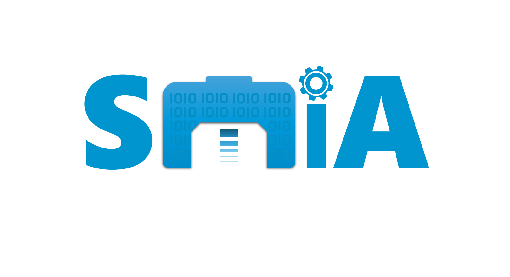

Getting Started
===============

|github| |pypi| |dockerhub| |youtube|

|doiScientific| |doiSW| |doiDataset|

----

.. |github| image:: https://img.shields.io/badge/github-%23121011.svg?style=for-the-badge&logo=github&logoColor=white
   :target: https://github.com/ekhurtado/SMIA
   :alt: GitHub

.. |readthedocs| image:: https://img.shields.io/badge/readthedocs-%238CA1AF.svg?style=for-the-badge&logo=readthedocs&logoColor=white
   :target: https://smia.readthedocs.io/en/latest/
   :alt: Read the Docs

.. |pypi| image:: https://img.shields.io/badge/pypi-%23008bdd.svg?style=for-the-badge&logo=pypi&logoColor=white
   :target: https://pypi.org/project/smia/
   :alt: PyPI

.. |dockerhub| image:: https://img.shields.io/badge/dockerhub-%233775A9.svg?style=for-the-badge&logo=docker&logoColor=white
   :target: https://hub.docker.com/r/ekhurtado/smia
   :alt: DockerHub

.. |youtube| image:: https://img.shields.io/badge/YouTube-%23FF0000.svg?style=for-the-badge&logo=YouTube&logoColor=white
   :target: https://youtube.com/playlist?list=PLs6bFF_iqW3HEwYAFOMHvW0xEngXnVF9K&si=UqWwelA3RO8C2A1u
   :alt: YouTube

.. |doiScientific| image:: https://img.shields.io/badge/Paper-Scientific-%23fab608.svg?style=for-the-badge&logo=doi&logoColor=white
   :target: https://doi.org/10.1016/j.jii.2025.100915
   :alt: DOIscientific

.. |doiSW| image:: https://img.shields.io/badge/Paper-Software-%23fab608.svg?style=for-the-badge&logo=doi&logoColor=white
   :target: https://doi.org/10.1016/j.simpa.2025.100807
   :alt: DOIsoftware

.. |doiDataset| image:: https://img.shields.io/badge/Dataset-Software-%23fab608.svg?style=for-the-badge&logo=doi&logoColor=white
   :target: https://doi.org/10.82518/R1IXE6
   :alt: DOIdataset

SMIA is a software that implements an AAS-compliant Digital Twin (DT) that is based on a flexible manufacturing-centered ontology.

The features of the SMIA approach include:

    - free & open-source
    - standardized approach (compliant with consolidated standards: AAS, CSS, FIPA, OWL, etc.)
    - Ontology-based
    - easily customizable and extendable
    - self-configuration at software startup
    - containerized solution

.. important::

    The SMIA software is developed as part of scientific research. If you use SMIA in scientific works, please cite the following articles.

    ``Scientific contribution``

    .. code:: text

        E. Hurtado, A. Burgos, A. Armentia, and O. Casquero, Self-configurable Manufacturing Industrial Agents (SMIA): a standardized approach for digitizing manufacturing assets, Journal of Industrial Information Integration, vol. 47, p. 100915, Sept. 2025, doi: 10.1016/j.jii.2025.100915

    ``Software contribution``

    .. code:: text

        E. Hurtado, I. Sarachaga, A. Armentia, and O. Casquero, An open-source reference framework for the implementation of type 3 Asset Administration Shells, Software Impacts, vol. 27, p. 100807, Apr. 2026, doi: 10.1016/j.simpa.2025.100807

Quick Start
-----------

New to SMIA? This section will guide you through getting started with the software quickly and easily.

.. dropdown:: 1. Easy installation
    :octicon:`terminal;1em;sd-text-primary`

    SMIA provides open-source code, as well as various installation methods. We recommend using the pip package manager, which allows you to install it with a single command:

    .. code:: bash

        pip install smia

    **Learn more:** :octicon:`repo;1em` :ref:`Installation Guide`

.. dropdown:: 2. Configuration of CSS-enriched AAS Model
    :octicon:`pencil;1em;sd-text-primary`

    SMIA self-configures from a valid CSS-enriched AAS model. For its generation, it is recommended the *AASX Package Explorer* editor (learn how to install and configure it on the :octicon:`repo;1em` :ref:`Installation Guide`).

    **Learn how to generate valid models:** :octicon:`repo;1em` :ref:`AAS Development Guide`

    .. tip::

        If you need to extend SMIA with increased autonomy (or add your own code), you can refer to the :octicon:`repo;1em` :ref:`SMIA Extension Guide`.

.. dropdown:: 3. Seamless deployment: Environment Builder
    :octicon:`rocket;1em;sd-text-primary`

    To automatically create deployment environments, we recommend using the dedicated *SMIA Environment Builder* tool, which is part of this documentation platform.

    This tool generates valid SMIA deployment environments based on your choices (local environments, or virtualized environments using Docker Compose or Kubernetes). It allows you to attach AASX models for asset digitization through SMIA and to select the necessary infrastructure.

    **Access it from:** :octicon:`repo;1em` :ref:`SMIA Environment Builder`

    .. tip::

        Especially for local environments, you can also follow the :octicon:`repo;1em` :ref:`SMIA Start-up Guide`.

.. dropdown:: 4. SMIA in operation
    :octicon:`gear;1em;sd-text-primary`

    SMIA agents are designed to be part of distributed systems, communicating via standardized FIPA-SMIACL messages. To verify that the SMIA agents are functioning properly, you can analyze directly the console or use one of the following tools:

    - **SMIA Operator:** extended agent that offers a graphical web interface to discover SMIA agents, and view their CSS-related information, and request CSS-related executions (completely abstracts the necessary FIPA-SMIACL interactions).
        **Learn more:** :octicon:`repo;1em` :ref:`SMIA ecosystem SMIA Operator`.
    - **SMIA PE:** extended agent with autonomy to interpret and automatically execute flexible BPMN workflows.
        **Learn more:** :octicon:`repo;1em` :ref:`SMIA ecosystem SMIA PE`.
    - **Direct communication:** Interact programmatically using FIPA-SMIACL messages when extending SMIA (see :octicon:`repo;1em` :ref:`SMIA Extension Guide`).

.. dropdown:: 5. Recommended Next Steps
    :octicon:`zap;1em;sd-text-primary`

    To learn more about the SMIA approach:

    - **Guided Tutorial:** Follow the :octicon:`repo;1em` :ref:`Step-by-step tutorials <Guided tutorials>` to achieve comprehensive implementation cases.
    - **Extend SMIA:** Read the :octicon:`repo;1em` :ref:`SMIA Extension Guide` to add new logic: custom agent capabilities, services, or asset connections.
    - **Analyze Use Cases:** Check :octicon:`repo;1em` :ref:`SMIA Use Cases` to see real-world applications.
    - **Explore the Ecosystem:** Look into the :octicon:`repo;1em` :ref:`SMIA ecosystem` for additional resources and tools available.
        - Start with simulated assets for initial full-scale local environments: :octicon:`repo;1em` :ref:`SMIA ecosystem Assets Simulators`.

Documentation project structure
-------------------------------

The SMIA project documentation repository is structured as follows:

    :octicon:`repo;1em` :ref:`SMIA User Guide`: these guides help with the usage of SMIA software and related tools.

    :octicon:`repo-pull;1em` :ref:`SMIA Use Cases`: these pages detail all the use cases developed within the SMIA approach.

    :octicon:`repo-pull;1em` :ref:`SMIA Environment Builder`: This page provides a tool for automating valid SMIA deployment environments.

    .. :octicon:`repo;1em` :ref:`AAS Developer Guide`: this guide helps with the development of the :term:`AAS model`, that is the basis for SMIA self-configuration.

    :octicon:`code-review;1em` :ref:`API documentation`: the entire documented source code of SMIA software.

    :octicon:`book;1em` :ref:`Glossary`: the glossary shows the list of terms relating to the SMIA approach.

    :octicon:`versions;1em` :ref:`Contributing`: shows the different ways to contribute to the SMIA approach.

    :octicon:`info;1em` :ref:`About the Project`: general information about the SMIA approach (e.g. contact information).

    :octicon:`link-external;1em` :ref:`Recommended Links`: information related to SMIA approach is available in this section.

    :octicon:`code-of-conduct;1em` :ref:`Code of Conduct`: the definition of community standards for the participation of the contributors.

    :octicon:`tag;1em` :ref:`Release Notes`: notes about all the releases and pre-releases of SMIA software development.

